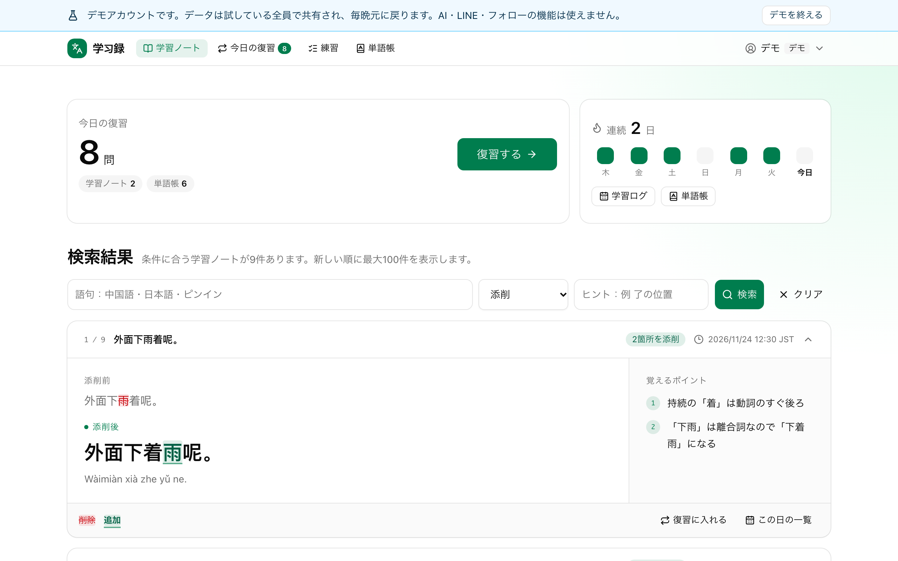
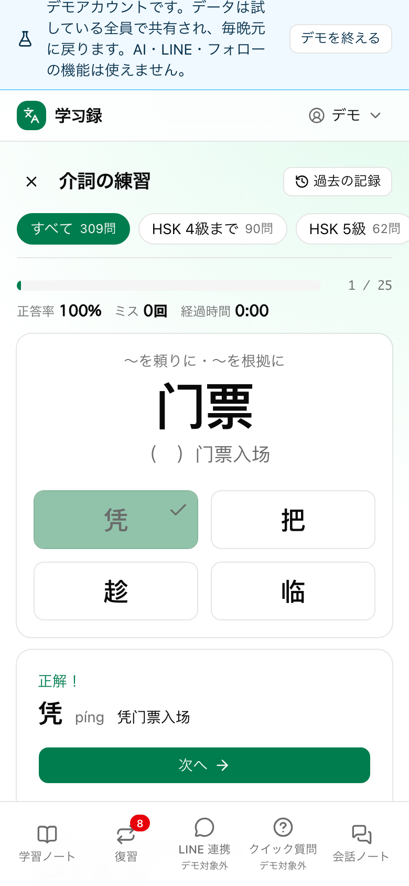
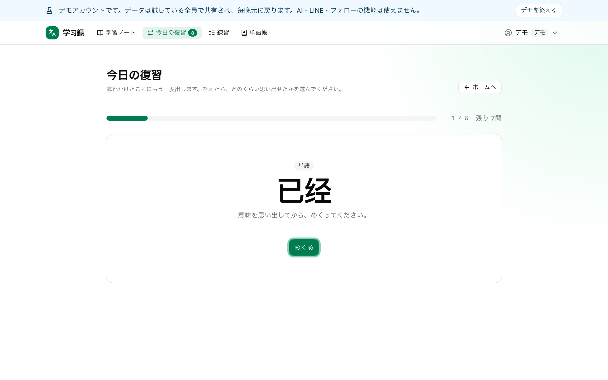

# 学习録

中国語の作文を添削してもらったあと、その学びを置きっぱなしにしないための学習ノートです。書いた文と添削後の文を、ピンインと覚えるべきヒントと一緒に残し、間隔反復の復習、単語帳、文法の練習問題へつなげます。

**本番**：<https://ffpf-zhuelog.sparklingstadt.com/>

| 学習ノート（PC）                                               | 練習（スマホ）                                            | 今日の復習（PC）                                      |
| -------------------------------------------------------------- | --------------------------------------------------------- | ----------------------------------------------------- |
|  |  |  |

## 試す

- **デモ**：ログイン画面の「デモで試す」で、例のデータが入った会員の画面（学習ノート、今日の復習、単語帳、会話ノート、練習の記録）を試せます。全員で 1 つのアカウントを使い、毎晩 04:00 ごろに元に戻ります（リセットは Web が行い、Vercel Cron（Web の `vercel.json`）が呼びます。Hobby の Cron は時刻が 1 時間単位で、最大 59 分遅れることがあります）。AI と LINE は使えません。
- **ゲスト**：ログイン画面の「ゲストとして使う」で、介詞・補語・量詞・了・过・着の練習を試せます。データは残りません。
- **会員**：ID とパスワードのアカウントは管理者が発行します。Sparklingstadt ID を持っている人は、自分でログインできます。

## できること

- **学習ノート**：添削前後の文、ピンイン、ヒントを CSV や LINE から取り込み、差分を色で見せます。日付別のログ、検索、ゴミ箱、フォローした人との共有があります。
- **今日の復習**：学習ノート、練習で間違えた問題、単語帳の語句を、FSRS（間隔反復）で忘れかけたころにもう一度出します。期日が来た朝には LINE で知らせます。
- **練習**：介詞、補語（結果・可能・程度・方向の 8 モード）、量詞、了・过・着の 4 択問題です。HSK 3.0 の級で絞れ、級の決め方は手作りの表と公式の語彙表（11,092 語）を切り替えられます。
- **単語帳**：例文や学習ノートから語句を入れ、ピンインと意味の下書きを AI が作ります。
- **AI**：LINE に送った文を添削・翻訳して学習ノートに入れます。「ChatGPT と話す」と「クイック質問」もあります。OpenAI を呼ぶたびにトークン数を記録し、管理者が月ごとの費用を見られます。
- **テーマ・スマホ**：ライトとダーク、スマホの下のタブがあります。

機能ごとの詳しい説明は [docs/features.md](docs/features.md) にあります。

## 技術構成

| 部分         | 使っているもの                                                                                                                                                                                                                                                                   |
| ------------ | -------------------------------------------------------------------------------------------------------------------------------------------------------------------------------------------------------------------------------------------------------------------------------- |
| Web          | Next.js 16（App Router、Server Components、Server Actions）、React 19、TypeScript、Tailwind CSS 4、shadcn/ui                                                                                                                                                                     |
| DB           | PostgreSQL 17（本番は Neon）。スキーマとマイグレーションは Prisma 7。Web がすべてのデータを Prisma で読み書きします。Prisma を import してよいのは `src/infrastructure/prisma/` だけです                                                                                         |
| 認証         | GitHub OAuth（PKCE）、ID とパスワード（scrypt。ハッシュの書き込みも確認も Web）、Sparklingstadt ID（OpenID Connect）、ゲスト。ログインはランダムなトークン（Cookie `zl_session`）のハッシュを DB の `Session` に置きます。期限は 30 日（ゲストは 24 時間）で、使っても延びません |
| 外部サービス | OpenAI API、LINE Messaging API                                                                                                                                                                                                                                                   |
| テスト       | Node の test runner、Playwright（PC とスマホの幅）、lefthook、GitHub Actions                                                                                                                                                                                                     |
| デプロイ     | Vercel（Web の 1 プロジェクト）。本番のマイグレーションはビルドで当てます。毎日の定期実行は Vercel Cron（`vercel.json`）                                                                                                                                                         |

## 設計の要点

- **DB は Prisma でだけ触る**：画面・Server Action・Route Handler は、`src/composition/` で組み立てた application のユースケースを呼び、DB は `src/infrastructure/prisma/` の store が Prisma で読み書きします。ログイン中の人は、Cookie `zl_session` のトークンから `Session` の行を引いて決めます。Prisma を import してよいのは `src/infrastructure/prisma/` だけで、pg と next-auth は import できません。これをテストで確かめています。
- **層を分ける**：Web のコードは `domain`・`application`・`infrastructure`・`presentation`・`composition` に分け、内側の層が Next.js や React に依存しないことを ESLint とテストで検査します。
- **復習を 1 つの列にする**：学習ノート、練習の間違い、単語帳の語句を、同じ FSRS のカードとして 1 つの「今日の復習」に並べます。
- **AI の費用を測ってから考える**：OpenAI を呼ぶ 4 か所のトークン数を記録し、料金や無料枠はその数字を見てから考える順にしました。
- **Go をやめて Next.js 1 つにした**：以前は Go の API を別に持っていましたが、自分で読んで処理を追えるように、2026 年 11 月に機能ごとに Next.js へ移し、Go を消しました（段階 0〜12）。経緯は [docs/architecture.md](docs/architecture.md) の 2. にあります。

全体の図、認証の流れ、選んだ理由と捨てた案は [docs/architecture.md](docs/architecture.md) にまとめています。

## 品質

- 単体テスト 799 件（TypeScript）、E2E 273 件（Playwright。PC の幅で 166 件、そのうち画面幅で結果が変わりうる 107 件はスマホの幅でも実行）があります。
- E2E は、Docker の Postgres、Web、OpenAI と LINE と Sparklingstadt ID のスタブを立ち上げて、本物の画面を通して確かめます。
- commit の前に format・lint・型チェック、push の前に単体テストと E2E を lefthook が走らせます。
- プルリクエストと main では、GitHub Actions の `verify` が同じ検査に `pnpm audit` と本番ビルドを足して走らせます。version を上げたマージは、`release` がタグと GitHub Release を作り、`deploy` が本番を切り替えます。
- 本番の Lighthouse（6 ページとも性能・ベストプラクティス・SEO が 100）とアクセシビリティの記録は [docs/quality.md](docs/quality.md) にあります。

## 手元で動かす

前提は Node.js 24 か 26、pnpm 11.25.0（`corepack enable`）、Docker です。

```bash
cp .env.example .env
pnpm install --frozen-lockfile
docker compose up -d --wait
pnpm run db:deploy
pnpm run db:seed:sample   # サンプルの会員（docs/development.md）
pnpm run dev
```

<http://localhost:3000> を開き、ゲストか、サンプルの会員（[docs/development.md](docs/development.md) の表）でログインします。認証の設定、テスト、本番への反映の手順は [docs/development.md](docs/development.md) にあります。

## 文書

| 文書                                                       | 中身                                     |
| ---------------------------------------------------------- | ---------------------------------------- |
| [docs/architecture.md](docs/architecture.md)               | 全体の設計と、選んだ理由                 |
| [docs/features.md](docs/features.md)                       | 機能ごとの説明                           |
| [docs/quality.md](docs/quality.md)                         | 表示速度とアクセシビリティの記録         |
| [docs/development.md](docs/development.md)                 | 手元での動かし方、認証の設定、テスト     |
| [docs/deployment.md](docs/deployment.md)                   | 本番への反映                             |
| [docs/releases/](docs/releases/)                           | リリースノート                           |
| [docs/roadmap.md](docs/roadmap.md)                         | これから取り組むこと                     |
| [docs/job-hunting-roadmap.md](docs/job-hunting-roadmap.md) | このアプリをポートフォリオに仕上げる計画 |

## ライセンス

All rights reserved です。ソースコードを読んでもらうために公開しています。詳しくは [LICENSE](LICENSE) を見てください。
