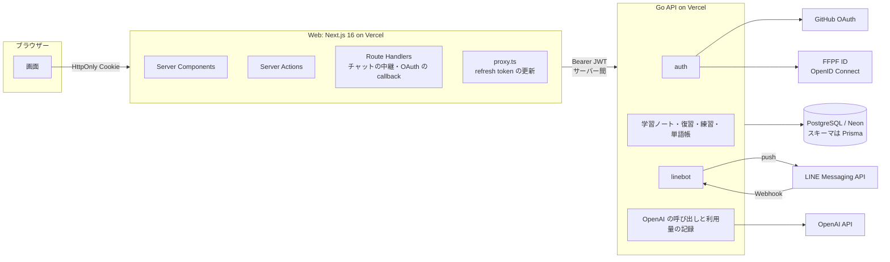
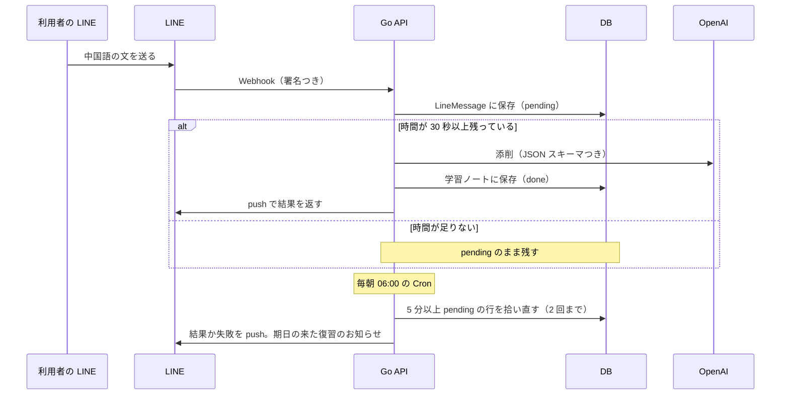

# 設計

学习録の全体の作りと、そう作った理由をまとめます。機能ごとの説明は [features.md](features.md)、手元での動かし方は [development.md](development.md)、機能を作ったときの設計と計画は [superpowers/specs/](superpowers/specs/) と [superpowers/plans/](superpowers/plans/) にあります。

## 1. 全体の図



- ブラウザーが話す相手は Web だけです。Go API を直接は呼びません。
- Web は DB に触りません。読み書きも、ログインも、AI も、すべて Go API を通します。
- LINE は Go API に Webhook を送ります。添削の結果は Go API が LINE に push で返します。

## 2. Web と Go API を分けた理由

最初は Next.js だけのアプリで、Auth.js と Prisma で DB を直接読んでいました。iOS アプリから自分の学習ノートを読み書きできるようにするため、ネイティブアプリ向けの Go API を作りました（[2026-10-20-go-mobile-api-design.md](superpowers/specs/2026-10-20-go-mobile-api-design.md)）。

すると、同じ規則（だれのノートを読めるか、CSV の上限、ログインの試行回数）を Web と Go の 2 か所に持つことになりました。そこで「画面は Next.js、データと認証は Go」に、3 段で寄せました（[2026-10-21-go-api-on-vercel-design.md](superpowers/specs/2026-10-21-go-api-on-vercel-design.md)）。

1. Go API を AWS ECS ではなく、Vercel の別プロジェクトで動かす。1 人で運用するので、置き場所を 1 つにまとめる。
2. Web のログインを Go API に移し、Auth.js をやめる（[web-auth-via-go-api](superpowers/specs/2026-10-21-web-auth-via-go-api-design.md)）。
3. Web のデータの読み書きを Go API に移し、Web の実行時から Prisma をなくす（[web-data-via-go-api](superpowers/specs/2026-10-22-web-data-via-go-api-design.md)）。

スキーマとマイグレーションは Prisma に残しました。Go は pgx で SQL を書きます。

**守っている決まり**：`src` から Prisma・pg・next-auth を import しないことを、`tests/architecture.test.ts` が検査します。

**捨てた案**：Go API を AWS ECS に置く案（最初の計画）。Vercel だけで足りると分かったので、置き場所を 1 つにしました。

## 3. Web の層

```text
src/
├── domain/          # エンティティ、値オブジェクト、リポジトリの契約（Next.js・React に依存しない）
├── application/     # ユースケースと外部サービスのポート
├── infrastructure/  # Go API の呼び出し、Cookie、設定の実装
├── presentation/    # 画面部品、Server Action、コントローラー、表示用の変換
├── composition/     # 実装を組み立ててユースケースを公開
└── app/             # Next.js App Router のエントリーポイント
```

依存は内側へ向けます。ESLint と `tests/architecture.test.ts` が、次のことを検査します。

- `domain`・`application` から、外側の層・Next.js・React・Prisma を import しない。
- `domain` から `application` を import しない。
- ポートには `Request`・`Response`・`Headers` を使わない。
- `domain`・`application` で `console` を使わない。

Web から Go API への呼び出しは `src/infrastructure/go-api/` にまとめています。

- **呼び出し方**：`fetch` は `cache: "no-store"` と `redirect: "error"` で呼び、10 秒で切ります（アップロードは 270 秒）。
- **ログインの切れ目**：トークンが無いときや、Go API が 401 を返したときは、ログイン画面へ送ります。
- **接続元の IP**：`X-Zhuelog-Client-IP` と共有の秘密（`X-Zhuelog-Proxy-Secret`）を一緒に送ります。Go API は、秘密が合うときだけその IP を信じます。

## 4. 認証

| ログイン        | 中身                                                                                     |
| --------------- | ---------------------------------------------------------------------------------------- |
| GitHub OAuth    | PKCE つき。管理者は GitHub の数字の ID の許可リスト（`AUTH_ALLOWED_GITHUB_IDS`）で決める |
| ID とパスワード | 管理者が発行する会員。パスワードは scrypt（N=2^15, r=8, p=1）                            |
| FFPF ID         | 自作の ID 基盤の OpenID Connect。ES256 の署名、iss・aud・nonce・exp を確かめる           |
| ゲスト          | データを持たない。練習だけ使える                                                         |

**トークン**

- Go API がアクセストークン（HS256 の JWT、15 分）と refresh token（30 日、ゲストは 24 時間）を発行します。
- Web はどちらも HttpOnly の Cookie に入れ、`proxy.ts` がアクセストークンの切れたときに更新します。

**refresh token**

- DB には SHA-256 のハッシュだけを置きます。
- 使うたびに新しいものに替えます（ローテーション）。替えたあとの古いトークンが使われたら、同じログインの系列（family）をまとめて無効にします。
- 例外として、ブラウザーの並行リクエストのため、30 秒だけは古いトークンも受け付けます。この 30 秒は、盗まれたトークンを見逃しうる時間として、わかったうえで受け入れています。

**失効**

- 会員はパスワードを変えると `sessionVersion` が上がり、古いトークンは次のリクエストで 401 になります。
- 管理者は、許可リストから外れた時点で 403 になります。

**試行回数**

- 接続元ごと、接続元とログイン ID の組ごとに、15 分の窓で数えます（`SignInThrottle`）。
- アカウントそのものはロックしません。ほかの場所からの失敗で、本人が締め出されないようにするためです。

**会員として操作**：管理者は、会員の画面を閲覧のみで見られます。トークンには、操作している管理者（ActorID）と、見ている会員（OwnerID）の両方が入ります。LINE の連携はできず、AI の利用量は管理者のほうに数えます。

## 5. 復習

- **計算**：[go-fsrs](https://github.com/open-spaced-repetition/go-fsrs)（FSRS v4）で次の期日を決めます。定着率 90%、学習中のステップは 1 分と 10 分です。評価は「もう一度・難しい・できた・簡単」の 4 段階です。
- **1 つの列にまとめる**：学習ノート、介詞と補語の練習の間違い、単語帳の語句を、どれも `ReviewItem`（`kind` と `targetId`）として同じ表に置きます。そのため、「今日の復習」は 1 つの列で済みます。FSRS のカードの状態（stability、difficulty、due など）は列に持ち、`(ownerId, due)` の索引で期日の来たものを引きます。
- **答えの記録**：答えは `ReviewLog` に残します。あとで FSRS のパラメーターを本人の記録に合わせられるようにするためです。
- **ゴミ箱との関係**：ゴミ箱に入れた学習ノートは、復習の列から外します。

## 6. 練習

**共通の部品**：介詞・補語・量詞・了・过・着の練習は、4 択の部品 `ChoicePractice` を共有します。間違えた選択肢には線を引き、正解するまで同じ問題を出します。

**記録**

- 介詞は `PrepositionPracticeRecord`、それ以外は `ComplementPracticeRecord` に `mode` を付けて残します。
- 量詞と了・过・着は、新しい表を作らずに `mode` の値（`measure`・`aspect`）を足しました。記録の一覧と「今日の復習」の作りを、そのまま使えるからです。

**HSK の級**：問題を、HSK 3.0 の「4 級まで・5 級・6 級以上」で絞れます。級の決め方は 2 通りあり、画面で切り替えられます。

- **手作りの表**：難しい語の表に載っている語が文に含まれるかで決めます。
- **公式の語彙表**：11,092 語の公式の語彙表で、文を最長一致で区切ります。いちばん難しい語の級を、生成スクリプトで前もって表にしておきます（[hsk-levels-official.md](hsk-levels-official.md)）。

**スマホ**：幅 640px 未満では、問題と 4 つの選択肢が下のタブより上に収まるように詰めます。正解すると「次へ」まで、次の問題では問題の上まで自動でスクロールします。

## 7. LINE



- 同じ Webhook が 2 回届いても、`webhookEventId` の一意制約で 1 回だけ処理します。
- Vercel の関数の時間切れで添削が終わらなかった文は、`pending` のまま残し、毎朝の Cron が拾い直します。
- 無料プランの push は月 200 通です。お知らせの前に残りを確かめ、拾い直しの返信のために 30 通を残します。

## 8. AI と費用

**呼ぶところ**：OpenAI を呼ぶのは Go API だけで、次の 4 か所です。どれも Responses API を使います。

| 機能              | モデル                           | 返し方                          |
| ----------------- | -------------------------------- | ------------------------------- |
| LINE の添削・翻訳 | `gpt-5-mini`                     | JSON スキーマで構造化した出力   |
| 単語帳の下書き    | `gpt-5-mini`                     | JSON スキーマで構造化した出力   |
| ChatGPT と話す    | 環境変数で変えられる（既定あり） | ストリーミング（NDJSON で中継） |
| クイック質問      | 同上                             | ストリーミング                  |

**利用量の記録**：呼ぶたびに、機能・モデル・入出力のトークン数を `AiUsage` に記録します。管理者は `/admin/ai-usage` で月ごとに見られます。入力した文や答えは記録しません。

**費用を測ってから考える**：はじめは有料化を考えていたので、料金や無料枠を決める前に、まず 1 人あたりの費用を測れるようにしました（v0.26.0）。商用利用はしないと決めたので、いまは費用を見張るための記録として使っています。

## 9. テスト

| 種類       | 数                    | 中身                                                                                          |
| ---------- | --------------------- | --------------------------------------------------------------------------------------------- |
| 単体（TS） | 371 件                | ドメインの規則、表示の変換、層の検査、Go API の呼び方                                         |
| Go         | テストファイル 81 本  | ハンドラー、認証、FSRS、CSV のパース。`store` は本物の Postgres に対して走る                  |
| E2E        | 200 件（PC とスマホ） | Playwright。Docker の Postgres、Go API、Web、OpenAI と FFPF ID のスタブを立ち上げて画面を通す |

- **E2E の土台**：`e2e/server.ts` が、マイグレーション、`next build`、スタブ、Go のビルドと起動を行います。テストのたびに表を空にします。
- **CSV のパースの移植**：Web から Go に移したとき、前の Web の出力を `testdata/expected.json`（約 45 件の CSV）に固定しました。Go の結果が同じことを確かめています。
- **lefthook**：commit の前に format・lint・型チェック、push の前に単体と E2E を走らせます。2026 年 11 月は GitHub Actions の枠を使い切ったので、このローカルの確認を関門にしました。

## 10. デプロイ

- **2 つのプロジェクト**：Vercel に Web と Go API の 2 つのプロジェクトがあります。Go API は Vercel の Go ランタイム（Fluid compute）で動きます。
- **マイグレーション**：本番のマイグレーションは、Web の本番ビルド（`scripts/vercel-build.sh`）が `prisma migrate deploy` で当てます。Go API は別にデプロイするので、マイグレーションは今動いている Go API と両立する形（表の追加、null を許す列の追加）にします。表や列の削除は 2 回のリリースに分けます。
- **DB**：Neon のプール接続を使い、ローカル以外では TLS の検証（`verify-full`）を強制します。

## 11. いまの課題

- **入力の検証が 2 か所にある**：ログイン ID・パスワード・表示名の規則や、チャットの本文の上限を、Web（zod）と Go の両方で持っています。Go が最後の砦で、Web は早く知らせるためですが、規則を変えるときは 2 か所を直す必要があります。
- **外部キーがない**：管理者は DB に行を持たないので、`ownerId` に外部キーがありません。持ち主の整合性は Go API のコードで守っています。
- **Preview の DB**：Preview の Go API がどの DB を使うかについて、文書の記述が食い違っています（`api-deployment.md` の 62 行目と 80 行目）。どちらかにそろえる必要があります。
- **CI が止まっている**：GitHub Actions の月の枠を使い切っています。枠が戻ったら、push ではジョブを軽くし、E2E は PR と main だけにする予定です（[job-hunting-roadmap.md](job-hunting-roadmap.md) の J4）。
- **層の検査に抜けがある**：`presentation` から `infrastructure` への import は、まだ制限していません。
