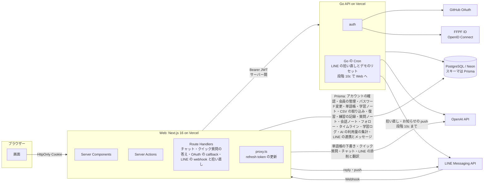
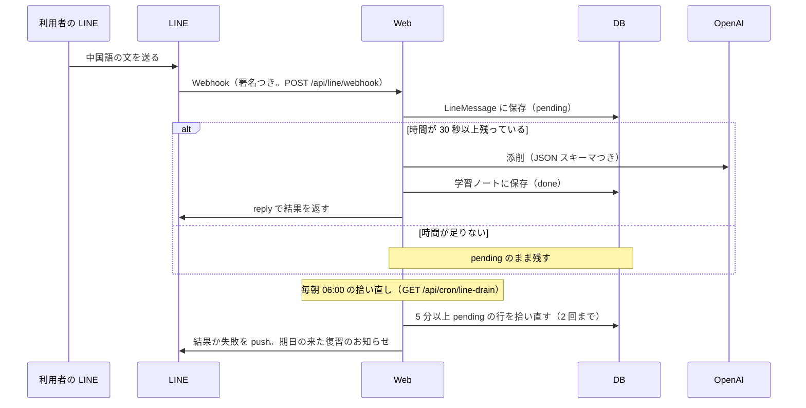

# 設計

学习録の全体の作りと、そう作った理由をまとめます。機能ごとの説明は [features.md](features.md)、手元での動かし方は [development.md](development.md)、機能を作ったときの設計と計画は [superpowers/specs/](superpowers/specs/) と [superpowers/plans/](superpowers/plans/) にあります。

## 1. 全体の図



- ブラウザーが話す相手は Web だけです。Go API を直接は呼びません。
- Web は、ログイン中の人を決めるために、実行時に DB のアカウント（`PasswordAccount`・`FfpfAccount`）を Prisma（`src/infrastructure/prisma/`）で読みます。アクセストークンも Web が自分で確かめます。単語帳（一覧・保存・削除）と学習ノート（一覧・検索・カレンダー・日ごとの表示・ゴミ箱・共有・CSV の取り込み）と練習の記録（介詞・補語）も Prisma で読み書きし（CSV は Web が自分で検証・解析し、1 つのトランザクションで保存します）、「AI で下書き」・クイック質問・ChatGPT と話すは Web が OpenAI を直接呼んで、使った量を `AiUsage` に記録し、質問ノートと会話ノートも Prisma で読み書きし、フォロー（会員の一覧・タイムライン・フォローする／外す）も Prisma で読み書きし、会員の管理（作成・一覧・パスワードの再設定）と自分のパスワードの変更も Prisma で書き（ハッシュは Web が scrypt で Go と同じ形に作ります）、学習ログ（カレンダー）と AI の利用量の月ごとの集計は Prisma で読むだけです。LINE も Web が受け、webhook の署名を確かめ、添削・翻訳の OpenAI を直接呼んで reply し、連携とメッセージ（`LineLink`・`LineLinkCode`・`LineMessage`）を Prisma で読み書きします。ログインと Cron は今も Go API を通します。機能は、設計書（[2026-11-16-deprecate-go-backend-design.md](superpowers/specs/2026-11-16-deprecate-go-backend-design.md)）の段階ごとに、Go から Web へ移していきます。
- LINE は Web の `POST /api/line/webhook` に Webhook を送ります。Web が署名を確かめ、OpenAI で添削・翻訳し、結果を reply で返します。段階 10b まで、Go API にも同じ LINE のルートが残っていますが、LINE の Webhook URL を Web に変えたあとは使いません。拾い直しと朝のお知らせは、Web にも `GET /api/cron/line-drain` が入りましたが（段階 10a）、Cron に登録するのは段階 10c です。それまでは、Go の Cron が `/v1/line/drain` を呼んで動かします。

## 2. Web と Go API を分けた理由

最初は Next.js だけのアプリで、Auth.js と Prisma で DB を直接読んでいました。iOS アプリから自分の学習ノートを読み書きできるようにするため、ネイティブアプリ向けの Go API を作りました（[2026-10-20-go-mobile-api-design.md](superpowers/specs/2026-10-20-go-mobile-api-design.md)）。

すると、同じ規則（だれのノートを読めるか、CSV の上限、ログインの試行回数）を Web と Go の 2 か所に持つことになりました。そこで「画面は Next.js、データと認証は Go」に、3 段で寄せました（[2026-10-21-go-api-on-vercel-design.md](superpowers/specs/2026-10-21-go-api-on-vercel-design.md)）。

1. Go API を AWS ECS ではなく、Vercel の別プロジェクトで動かす。1 人で運用するので、置き場所を 1 つにまとめる。
2. Web のログインを Go API に移し、Auth.js をやめる（[web-auth-via-go-api](superpowers/specs/2026-10-21-web-auth-via-go-api-design.md)）。
3. Web のデータの読み書きを Go API に移し、Web の実行時から Prisma をなくす（[web-data-via-go-api](superpowers/specs/2026-10-22-web-data-via-go-api-design.md)）。

スキーマとマイグレーションは Prisma に残しました。Go は pgx で SQL を書きます。

**守っている決まり**：`src` から Prisma・pg・next-auth を import しないことを、`tests/architecture.test.ts` が検査します。

**捨てた案**：Go API を AWS ECS に置く案（最初の計画）。Vercel だけで足りると分かったので、置き場所を 1 つにしました。

## 3. Web の層

```text
src/
├── domain/          # エンティティ、値オブジェクト、リポジトリの契約（Next.js・React に依存しない）
├── application/     # ユースケースと外部サービスのポート
├── infrastructure/  # Go API の呼び出し、Cookie、設定の実装
├── presentation/    # 画面部品、Server Action、コントローラー、表示用の変換
├── composition/     # 実装を組み立ててユースケースを公開
└── app/             # Next.js App Router のエントリーポイント
```

依存は内側へ向けます。ESLint と `tests/architecture.test.ts` が、次のことを検査します。

- `domain`・`application` から、外側の層・Next.js・React・Prisma を import しない。
- `domain` から `application` を import しない。
- ポートには `Request`・`Response`・`Headers` を使わない。
- `domain`・`application` で `console` を使わない。

Web から Go API への呼び出しは `src/infrastructure/go-api/` にまとめています。

- **呼び出し方**：`fetch` は `cache: "no-store"` と `redirect: "error"` で呼び、10 秒で切ります（アップロードは 270 秒）。
- **ログインの切れ目**：トークンが無いときや、Go API が 401 を返したときは、ログイン画面へ送ります。
- **接続元の IP**：`X-Zhuelog-Client-IP` と共有の秘密（`X-Zhuelog-Proxy-Secret`）を一緒に送ります。Go API は、秘密が合うときだけその IP を信じます。

## 4. 認証

| ログイン        | 中身                                                                                                                                                                                                                                                                   |
| --------------- | ---------------------------------------------------------------------------------------------------------------------------------------------------------------------------------------------------------------------------------------------------------------------- |
| GitHub OAuth    | PKCE つき。管理者は GitHub の数字の ID の許可リスト（`AUTH_ALLOWED_GITHUB_IDS`）で決める                                                                                                                                                                               |
| ID とパスワード | 管理者が発行する会員。パスワードは scrypt（N=2^15, r=8, p=1）。Web が `src/infrastructure/security/scrypt-password-hasher.ts` で書き、Go のログインが確かめる。`tests/fixtures/scrypt-golden.json`（Go の `password_golden_test.go` が書く）で両者が同じことを確かめる |
| FFPF ID         | 自作の ID 基盤の OpenID Connect。ES256 の署名、iss・aud・nonce・exp を確かめる                                                                                                                                                                                         |
| ゲスト          | データを持たない。練習だけ使える                                                                                                                                                                                                                                       |

**トークン**

- Go API がアクセストークン（HS256 の JWT、15 分）と refresh token（30 日、ゲストは 24 時間）を発行します。
- Web はどちらも HttpOnly の Cookie に入れ、`proxy.ts` がアクセストークンの切れたときに更新します。

**refresh token**

- DB には SHA-256 のハッシュだけを置きます。
- 使うたびに新しいものに替えます（ローテーション）。替えたあとの古いトークンが使われたら、同じログインの系列（family）をまとめて無効にします。
- 例外として、ブラウザーの並行リクエストのため、30 秒だけは古いトークンも受け付けます。この 30 秒は、盗まれたトークンを見逃しうる時間として、わかったうえで受け入れています。

**失効**

- 会員はパスワードを変えると `sessionVersion` が上がり、古いトークンは次のリクエストで 401 になります。管理者がパスワードを再設定したときも同じです。変更も再設定も、Web が 1 つの `UPDATE` でハッシュと `sessionVersion` を変えます。Go のログインと refresh も、Web も、次のリクエストで古いセッションを断ります。
- 管理者は、許可リストから外れた時点で 403 になります。

**試行回数**

- 接続元ごと、接続元とログイン ID の組ごとに、15 分の窓で数えます（`SignInThrottle`）。
- アカウントそのものはロックしません。ほかの場所からの失敗で、本人が締め出されないようにするためです。

**会員として操作**：管理者は、会員の画面を閲覧のみで見られます。トークンには、操作している管理者（ActorID）と、見ている会員（OwnerID）の両方が入ります。LINE の連携はできず（LINE 連携の画面は `/` に戻ります）、AI の利用量は管理者のほうに数えます。

## 5. 復習

- **計算**：FSRS v4 で次の期日を決めます。Web が `src/domain/review/fsrs.ts`（[go-fsrs](https://github.com/open-spaced-repetition/go-fsrs) を手で移した TypeScript）で計算し、`ReviewItem` と `ReviewLog` も Prisma で直接読み書きします。Go の `review` パッケージには同じ計算が残っていて（デモのリセットだけが `review.NewCard` と `review.Next` を使います）、`tests/fixtures/fsrs-golden.json` で両者の結果が同じことをテストで確かめます（golden ファイルは Go の `golden_test.go` が書き、Web のテストが読みます）。定着率 90%、学習中のステップは 1 分と 10 分です。評価は「もう一度・難しい・できた・簡単」の 4 段階です。
- **1 つの列にまとめる**：学習ノート、介詞と補語の練習の間違い、単語帳の語句を、どれも `ReviewItem`（`kind` と `targetId`）として同じ表に置きます。そのため、「今日の復習」は 1 つの列で済みます。FSRS のカードの状態（stability、difficulty、due など）は列に持ち、`(ownerId, due)` の索引で期日の来たものを引きます。
- **答えの記録**：答えは `ReviewLog` に残します。あとで FSRS のパラメーターを本人の記録に合わせられるようにするためです。
- **ゴミ箱との関係**：ゴミ箱に入れた学習ノートは、復習の列から外します。

## 6. 練習

**共通の部品**：介詞・補語・量詞・了・过・着の練習は、4 択の部品 `ChoicePractice` を共有します。間違えた選択肢には線を引き、正解するまで同じ問題を出します。

**記録**

- 介詞は `PrepositionPracticeRecord`、それ以外は `ComplementPracticeRecord` に `mode` を付けて残します。
- 量詞と了・过・着は、新しい表を作らずに `mode` の値（`measure`・`aspect`）を足しました。記録の一覧と「今日の復習」の作りを、そのまま使えるからです。
- 記録は Web が Prisma で読み書きします。保存と同じトランザクションで、間違えた問題を `ReviewItem` に入れます。同じ id の保存をやり直しても記録は 1 つのままで、ほかの人の id は上書きしません。すでに列にある問題は、期日が先なら期日だけを今に戻し、FSRS の状態は残します。
- 列に入れる処理は、読んでから書くのではなく、1 つの文（`INSERT … ON CONFLICT … DO UPDATE … WHERE "due" > EXCLUDED."due"`）です。復習の答えは同じ行を `FOR UPDATE` で取って FSRS の列を書き換えるので、読んでから書くと同時に起きたとき片方が消えます。1 つの文なら、答えのロックを待ってから、確定した行に対して条件を確かめるので、どちらの書き込みも消えません。

**HSK の級**：問題を、HSK 3.0 の「4 級まで・5 級・6 級以上」で絞れます。級の決め方は 2 通りあり、画面で切り替えられます。

- **手作りの表**：難しい語の表に載っている語が文に含まれるかで決めます。
- **公式の語彙表**：11,092 語の公式の語彙表で、文を最長一致で区切ります。いちばん難しい語の級を、生成スクリプトで前もって表にしておきます（[hsk-levels-official.md](hsk-levels-official.md)）。

**スマホ**：幅 640px 未満では、問題と 4 つの選択肢が下のタブより上に収まるように詰めます。正解すると「次へ」まで、次の問題では問題の上まで自動でスクロールします。

## 7. LINE



- Web の入口は `src/app/api/line/webhook/route.ts`（Webhook）と `src/app/api/cron/line-drain/route.ts`（拾い直しと朝のお知らせ）です。Webhook は署名を、リクエストの生のバイト列に対して確かめます。連携の画面（`/account/line`）と Server Actions も Web が Prisma で読み書きし、Go を呼びません。
- **Cron はまだ Web にありません**：`/api/cron/line-drain` は段階 10a で入りましたが、Vercel Cron には登録していません（登録は段階 10c）。それまでは、Go の Cron（`services/api/vercel.json`）が毎朝 06:00（日本時間）に、Go の `/v1/line/drain` を呼びます。Go と Web は同じ表（`LineLink`・`LineLinkCode`・`LineMessage`）を同じ意味で使うので、どちらが拾い直しても結果は同じです。Go の LINE のコードは段階 10b で消えます。
- 同じ Webhook が 2 回届いても、`webhookEventId` の一意制約で 1 回だけ処理します。
- Vercel の関数の時間切れで添削が終わらなかった文は、`pending` のまま残し、毎朝の拾い直しが拾い直します。
- 無料プランの push は月 200 通です。お知らせの前に残りを確かめ、拾い直しの返信のために 30 通を残します。

## 8. AI と費用

**呼ぶところ**：OpenAI を呼ぶのは次の 4 か所で、すべて Web（`src/infrastructure/openai/`）です（LINE の添削・翻訳は `line-learning.ts`。段階 10b まで、Go にも古い呼び出しが残っています）。どれも Responses API を使います。

| 機能              | モデル                           | 返し方                                                    |
| ----------------- | -------------------------------- | --------------------------------------------------------- |
| LINE の添削・翻訳 | `gpt-5-mini`                     | JSON スキーマで構造化した出力                             |
| 単語帳の下書き    | `gpt-5-mini`                     | JSON スキーマで構造化した出力                             |
| ChatGPT と話す    | 環境変数で変えられる（既定あり） | ストリーミング（Web の Route Handler から NDJSON で直接） |
| クイック質問      | 同上                             | ストリーミング（Web の Route Handler から NDJSON で直接） |

ストリーミングの 2 つは、テキストが出る前の失敗なら 502、出たあとの失敗なら `error` の行で伝えます。ChatGPT と話すは、トークンの上限で切れた答えもそのまま保存します。クイック質問は、途中で切れた答えを保存しません。

**利用量の記録**：呼ぶたびに、機能・モデル・入出力のトークン数を `AiUsage` に記録します。管理者は `/admin/ai-usage` で月ごとに見られます。入力した文や答えは記録しません。

**費用を測ってから考える**：はじめは有料化を考えていたので、料金や無料枠を決める前に、まず 1 人あたりの費用を測れるようにしました（v0.26.0）。商用利用はしないと決めたので、いまは費用を見張るための記録として使っています。

## 9. テスト

| 種類       | 数                    | 中身                                                                                                  |
| ---------- | --------------------- | ----------------------------------------------------------------------------------------------------- |
| 単体（TS） | 378 件                | ドメインの規則、表示の変換、層の検査、Go API の呼び方                                                 |
| Go         | テストファイル 81 本  | ハンドラー、認証、FSRS。`store` は本物の Postgres に対して走る                                        |
| E2E        | 206 件（PC とスマホ） | Playwright。Docker の Postgres、Go API、Web、OpenAI と LINE と FFPF ID のスタブを立ち上げて画面を通す |

- **E2E の土台**：`e2e/server.ts` が、マイグレーション、`next build`、スタブ、Go のビルドと起動を行います。テストのたびに表を空にします。
- **CSV のパースの検証**：CSV の取り込みを Web に戻したので、約 45 件の CSV の見本は `tests/fixtures/learning-csv/` にあり、TS のパーサー（csv-parse）がその見本と同じ結果を返すことを確かめています。
- **lefthook**：commit の前に format・lint・型チェック、push の前に単体と E2E を走らせます。GitHub Actions の CI は置いていないので、このローカルの確認が関門です。

## 10. デプロイ

- **2 つのプロジェクト**：Vercel に Web と Go API の 2 つのプロジェクトがあります。Go API は Vercel の Go ランタイム（Fluid compute）で動きます。
- **マイグレーション**：本番のマイグレーションは、Web の本番ビルド（`scripts/vercel-build.sh`）が `prisma migrate deploy` で当てます。Go API は別にデプロイするので、マイグレーションは今動いている Go API と両立する形（表の追加、null を許す列の追加）にします。表や列の削除は 2 回のリリースに分けます。
- **DB**：Neon のプール接続を使い、ローカル以外では TLS の検証（`verify-full`）を強制します。

## 11. いまの課題

- **入力の検証が 2 か所にある**：会員の作成とパスワードの規則は Web（`src/domain/identity/password-account.ts`）だけになりました。Go に残るのは、ログインのときのログイン ID の正規化（`NormalizeLoginID`、同じ規則）だけです。この規則を変えるときは、Web と Go の 2 か所を直す必要があります。
- **外部キーがない**：管理者は DB に行を持たないので、`ownerId` に外部キーがありません。持ち主の整合性はコードで守っています（フォローは、相手のアカウントがあるときだけ行を足す 1 つの SQL）。
- **Preview の DB**：Preview の Go API がどの DB を使うかについて、文書の記述が食い違っています（`api-deployment.md` の 62 行目と 80 行目）。どちらかにそろえる必要があります。
- **CI がない**：GitHub Actions の CI は外しました。確認は lefthook のローカルの検査だけで、`pnpm audit` と `pnpm run build` は自動では走りません。
- **層の検査に抜けがある**：`presentation` から `infrastructure` への import は、まだ制限していません。
