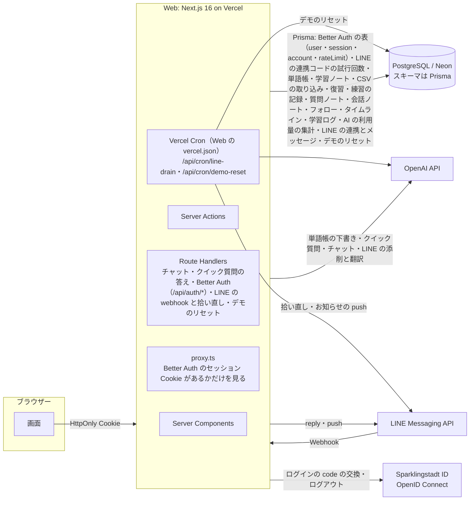
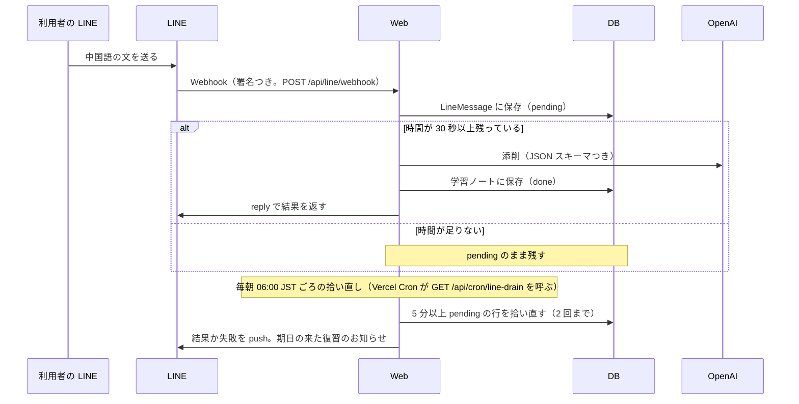

# 設計

学习録の全体の作りと、そう作った理由をまとめます。機能ごとの説明は [features.md](features.md)、手元での動かし方は [development.md](development.md)、機能を作ったときの設計と計画は [superpowers/specs/](superpowers/specs/) と [superpowers/plans/](superpowers/plans/) にあります。

## 1. 全体の図



- アプリは Next.js 1 つです。ブラウザーが話す相手は Web だけで、Vercel のプロジェクトも 1 つです。
- Web は、ログイン中の人を決めるために、実行時に Better Auth の `session` と `user` の行を Prisma（`src/infrastructure/prisma/`）で読みます（Better Auth のアダプターが読みます）。単語帳（一覧・保存・削除）と学習ノート（一覧・検索・カレンダー・日ごとの表示・ゴミ箱・共有・CSV の取り込み）と練習の記録（介詞・補語）も Prisma で読み書きし（CSV は Web が自分で検証・解析し、1 つのトランザクションで保存します）、「AI で下書き」・クイック質問・ChatGPT と話すは Web が OpenAI を直接呼んで、使った量を `AiUsage` に記録し、質問ノートと会話ノートも Prisma で読み書きし、フォロー（会員の一覧・タイムライン・フォローする／外す）も Prisma で読み書きし、学習ログ（カレンダー）と AI の利用量の月ごとの集計は Prisma で読むだけです。会員の管理（作成・一覧・パスワードの再設定・なりすまし）と自分のパスワードの変更は、Better Auth の `admin` プラグインと `changePassword` が行います（ハッシュは scrypt のままです）。LINE も Web が受け、webhook の署名を確かめ、添削・翻訳の OpenAI を直接呼んで reply し、連携とメッセージ（`LineLink`・`LineLinkCode`・`LineMessage`）を Prisma で読み書きします。デモのリセットも Web が 1 つのトランザクションで行います。ログイン（ID とパスワード・Sparklingstadt ID・ゲスト・デモ）とログアウトは Better Auth が行います（下の「4. 認証」）。以前はこれらを Go の API が受け持っていましたが、段階 0〜12 で Web に移し、Go を消しました（下の「2.」）。
- LINE は Web の `POST /api/line/webhook` に Webhook を送ります。Web が署名を確かめ、OpenAI で添削・翻訳し、結果を reply で返します。拾い直しと朝のお知らせは Web の `GET /api/cron/line-drain` で、Web の `vercel.json` の Cron が毎日 06:00 JST ごろに呼びます。

## 2. Go API をやめて Next.js 1 つにした理由

**以前の形**：最初は Next.js だけのアプリで、Auth.js と Prisma で DB を直接読んでいました。2026 年 10 月、iOS アプリから自分の学習ノートを読み書きできるようにするため、ネイティブアプリ向けの Go API を作りました（[2026-10-20-go-mobile-api-design.md](superpowers/specs/2026-10-20-go-mobile-api-design.md)）。同じ規則を Web と Go の 2 か所に持たないように、「画面は Next.js、データと認証は Go」に寄せ、Web も Go の API を呼ぶ形にしました（[2026-10-21-go-api-on-vercel-design.md](superpowers/specs/2026-10-21-go-api-on-vercel-design.md)）。Go は Vercel の別のプロジェクトで動き、Web は `src/infrastructure/go-api/` のアダプタで Go を呼び、ログインは Go の JWT と refresh token でした。

**やめた理由**：AI のサブスクリプションをやめるにあたり、AI がなくても持ち主が自分で保守できる Next.js（TypeScript）1 つにそろえ、このアプリを Next.js を学ぶ教材にすることにしたためです。Go を学ぶよりも、Next.js を深く理解することを優先しました（[2026-11-16-deprecate-go-backend-design.md](superpowers/specs/2026-11-16-deprecate-go-backend-design.md)）。ネイティブアプリ向けの `/v1/...` の API と JWT も、一緒にやめました。

**進め方**：機能ごとに 1 本ずつ PR にして移しました（段階 0〜12。2026 年 11 月）。まず Web が Prisma で DB に直接つなげるようにし、単語帳・学習ノート・CSV・復習・練習の記録・質問・チャット・学習ログ・フォロー・会員の管理・LINE とデモのリセットの順に移し、最後にログインを移して（段階 11）、Go を消しました（段階 12）。どの PR も単独で本番に出せ、差分は 1 機能ぶんです。各段階の本番への反映の手順は、[deployment.md](deployment.md) の「移行の記録」に残しています。段階 12b で `ApiRefreshToken` を消し、Go の移行が終わりました（2026 年 11 月）。

**捨てた案**

- **ログインを先に移す**：途中で Go を「Next.js のセッションを受け取る側」に作り変える必要があり、これからやめる Go に最初に手を入れることになるため、採りませんでした。
- **まとめて書き直して一度に切り替える**：数万行の差分を一度に確かめることになり、1 機能ずつ移しながら Next.js での書き方を確かめるという目的に反するため、採りませんでした。

**守っている決まり**：Prisma を import してよいのは `src/infrastructure/prisma/` だけで、pg と next-auth は import できません。`better-auth` のサーバー側は `src/infrastructure/auth/` だけ、ブラウザー用のクライアント（`better-auth/react`）は `src/presentation/` だけが import できます。これを `tests/architecture.test.ts` が検査します。

**コードのコメントと Go**：`src/`・`tests/`・`e2e/` のコメントは、いまのコードが何をし、なぜそうするかだけを書いています。消した Go のファイルや関数を基準にした説明はありません。残っているのは、Go が書いた固定のテストデータ（`tests/fixtures/` の `scrypt-golden.json`・`fsrs-golden.json`・`demo-seed-golden.json`）の由来と、復習の計算が従っているライブラリ go-fsrs の名前だけです。Go のどの処理を移したかは、下の表の計画と `*-go-reference.md` に残しています。

**どこを読めば何が分かるか**

| 知りたいこと                        | 読む所                                                                                                                                                                                                                                                                       |
| ----------------------------------- | ---------------------------------------------------------------------------------------------------------------------------------------------------------------------------------------------------------------------------------------------------------------------------- |
| 層の分け方と、どこから読むか        | `docs/architecture.md`（3. Web の層）、`src/composition/*-container.ts`（機能ごとの組み立て。ここから application と store へたどれる）                                                                                                                                      |
| ログイン中の人の決め方              | `src/composition/current-user.ts` → `src/infrastructure/identity/better-auth-current-user-provider.ts`（Better Auth の `getSession` の答えから役割を決める）                                                                                                                 |
| ログイン・ログアウト                | Better Auth の設定は `src/infrastructure/auth/better-auth.ts`・`better-auth-rules.ts`、ハンドラーは `src/app/api/auth/[...all]/route.ts`、デモ・ログアウト・なりすましは `src/composition/identity-container.ts`、画面からの呼び出しは `src/presentation/lib/auth-client.ts` |
| ページの門番（Proxy）               | `src/proxy.ts` → `src/presentation/http/session-gate.ts`（Better Auth の Cookie があるかだけを見る。読み方は `src/infrastructure/auth/session-cookie.ts`）                                                                                                                   |
| 学習ノート・ゴミ箱・共有・検索・CSV | `src/application/learning/learning-notes.ts`、`src/infrastructure/prisma/learning-note-reads.ts`・`learning-note-writes.ts`・`learning-csv-import.ts`                                                                                                                        |
| 復習（FSRS）                        | `src/application/review/review-queue.ts`、`src/domain/review/`、`src/infrastructure/prisma/review-store.ts`                                                                                                                                                                  |
| 練習の記録・質問・チャット          | `src/application/practice/`・`src/application/chat/`、`src/infrastructure/prisma/practice-record-store.ts`・`question-store.ts`・`conversation-store.ts`、`src/app/api/chat/route.ts`                                                                                        |
| 単語帳・学習ログ・AI の利用量       | `src/application/vocabulary/`・`study-log/`・`ai-usage/`、対応する `src/infrastructure/prisma/*-store.ts`、OpenAI は `src/infrastructure/openai/`                                                                                                                            |
| フォロー・会員の管理・パスワード    | `src/application/social/social-network.ts`、`src/application/identity/member-accounts.ts`・`own-password.ts`、`src/infrastructure/prisma/social-store.ts`・`member-users.ts`                                                                                                 |
| LINE と cron                        | `src/app/api/line/webhook/route.ts`・`src/app/api/cron/*/route.ts` → `src/application/line/line-bot.ts`・`src/application/demo/demo-reset.ts`、`vercel.json` の `crons`                                                                                                      |
| 失敗したときの画面の文言とログ      | `src/presentation/controllers/action-state.ts`・`load-or.ts`                                                                                                                                                                                                                 |
| 各段階で Go の何をどこへ移したか    | 各段階の計画（`docs/superpowers/plans/2026-11-16-deprecate-go-stage*.md`）と、`*-go-reference.md`（Go の処理の `file:line` の記録）、各 PR の説明の対応表                                                                                                                    |
| 消した Go のファイルの中身          | 計画と `*-go-reference.md` に出てくる Go のファイル（`services/api/` の下にありました）を、`git show "$(git log -1 --format=%H -- <道>)^:<道>"` で読む                                                                                                                       |
| 本番への反映と、各段階で行った手順  | `docs/deployment.md`（「移行の記録（段階 1〜12）」）                                                                                                                                                                                                                         |

## 3. Web の層

```text
src/
├── domain/          # エンティティ、値オブジェクト、規則（Next.js・React に依存しない）
├── application/     # ユースケース。使う store や外部サービスの形を、引数の型として持つ
├── infrastructure/  # Prisma、Cookie とセッション、OAuth、OpenAI、設定の実装
├── presentation/    # 画面部品、Server Action、コントローラー、表示用の変換
├── composition/     # 実装を組み立ててユースケースを公開
└── app/             # Next.js App Router のエントリーポイント
```

依存は内側へ向けます。ESLint と `tests/architecture.test.ts` が、次のことを検査します。

- `domain`・`application` から、外側の層・Next.js・React・Prisma を import しない。
- `domain` から `application` を import しない。
- ポートには `Request`・`Response`・`Headers` を使わない。
- `domain`・`application` で `console` を使わない。
- `app`・`presentation` から、DB と OpenAI の部品（`infrastructure/prisma`・`infrastructure/openai`）を import しない。DB と OpenAI には、`composition` が組み立てたユースケースを通して届く。
- 画面部品（`presentation/components`）から `infrastructure` を import しない。ブラウザーの設定は `composition/browser-preferences.ts` を通す。

`presentation` と `app` は、Cookie・ヘッダー・署名の処理（`infrastructure` の `auth`・`preferences`・`security`・`line`・`config`）は直接 import してよいことにしています。どれも HTTP のやり取りそのもので、`composition` から転送し直しても名前が増えるだけだからです。

- **ログインの切れ目**：Better Auth の Cookie が無いときは Proxy が、行が無い・期限切れのときは各ページと Server Action が、ログイン画面へ送ります。
- **接続元の IP**：`x-real-ip`（無ければ `x-forwarded-for`）を Better Auth が読み、ログインのレート制限に使います（下の「4. 認証」の「試行回数」）。

## 4. 認証

ログインとログアウトは、Better Auth 1.7.28 が `/api/auth/*`（`src/app/api/auth/[...all]/route.ts`）で行います。設定は `src/infrastructure/auth/better-auth.ts`、設定の判断の部分は `better-auth-rules.ts` にあります（DB も要求も使わない関数なので、そのまま単体テストできます）。設計は [2026-11-27-better-auth-migration-design.md](superpowers/specs/2026-11-27-better-auth-migration-design.md) にあります。以前の自前のログイン（GitHub ログイン、自前のセッション、会員ごとのアカウントの表）は、この切り替えで消しました。

| ログイン          | 中身                                                                                                                                                                                                                                                                                                                                                                                                                                                                                                                   |
| ----------------- | ---------------------------------------------------------------------------------------------------------------------------------------------------------------------------------------------------------------------------------------------------------------------------------------------------------------------------------------------------------------------------------------------------------------------------------------------------------------------------------------------------------------------- |
| ID とパスワード   | 管理者が作る会員。`username` プラグインで、ログイン ID は `user.username`（英小文字・数字・`.` `_` `-` の 3〜32 文字。入力は前後の空白を除いて小文字にしてから確かめる）。パスワードは scrypt（N=2^15, r=8, p=1）のまま（`src/infrastructure/security/scrypt-password-hasher.ts`）で、`account`（`providerId` は `credential`）に置く。`tests/fixtures/scrypt-golden.json` は、以前の Go が書いた固定のファイル。会員は自分で登録できず（`disableSignUp`）、メールアドレスでのログイン（`/sign-in/email`）も閉じている |
| Sparklingstadt ID | 自作の ID サーバー（sparklingstadt-id）の OpenID Connect。`genericOAuth` の `providerId: "sid"`（discovery、PKCE、`client_secret_basic`）。ID トークンの検証は Better Auth に任せ、検証に必要な issuer と JWKS が discovery で取れないときは、ID トークンを未検証で受けずにこのログインを使えなくする（`requireIdTokenVerification`）。誰でも入れて、初めてのログインで `user` と `account` ができる。管理者は、`user.role` が `admin` の人で、この道で入る                                                            |
| ゲスト            | `anonymous` プラグイン。データを持たず、練習だけ使える。ゲストの `user` は、毎日のデモのリセットの cron が、作ってから 24 時間たったものを消す                                                                                                                                                                                                                                                                                                                                                                         |
| デモ              | `DEMO_LOGIN_ID` の会員に、「デモで試す」から入る。Server Action が `DEMO_PASSWORD` で `auth.api.signInUsername` を呼ぶ（パスワードなしで入る道はない）。全員で 1 つのアカウントを使う                                                                                                                                                                                                                                                                                                                                  |

**redirect_uri**：Sparklingstadt ID の callback は `<AUTH_URL の origin>/api/auth/callback/sid` で、以前と同じです。ログアウトの戻り先 `post_logout_redirect_uri` は `<AUTH_URL の origin>/signin` で、ID サーバーのクライアントに登録した URL と 1 文字でも違うと、ID サーバーがログアウトの戻りを断ります。`AUTH_URL` が無いと `baseURL` は本番の URL になるので、Preview では必ず `AUTH_URL` を入れます（そうしないと、SID と origin の確かめが通りません）。

**アカウントのつなぎ方**：SID の `account` は `sub` でだけ `user` につなぎます（`disableImplicitLinking`）。メールアドレスが同じというだけでは、つなぎません。ID サーバーが管理者のメールアドレスを名乗る人にコードを出しても、その人が管理者にならないようにするためです。管理者の `user` と `sub` は、切り替えのときに `scripts/prepare-better-auth-admin.ts` が前もって用意します（[deployment.md](deployment.md) の「移行の記録」）。

**セッション**

- Better Auth の Cookie（`better-auth.session_token`。HTTPS では `__Secure-` が付く）に、署名したトークンを置き、DB の `session` に行を持ちます。期限は 30 日（ゲストも同じ）で、使うと延びます（Better Auth の既定の `updateAge`）。ログインのたびに新しいトークンです。
- ログアウトは、自分の `session` の行を消し、Cookie を消します。DB が失敗しても、Cookie は消します。SID でログインした人は、続けて ID サーバーの `end_session_endpoint` へ送り、ID サーバーのログインも消します。
- **毎回の確かめ**：各ページ・Server Action・Route Handler が `auth.api.getSession` で、Cookie から `session` と `user` の行を引きます。役割は、`isAnonymous` ならゲスト、`role` が `admin` なら管理者、それ以外は会員です。`banned` の人は通しません。デモは、`username` が `DEMO_LOGIN_ID` の会員です。
- **Proxy**：`src/proxy.ts` は、Better Auth の Cookie があるかだけを見ます。DB は読まず、更新もしません。無ければログイン画面へ送ります。

**失効**

- 会員がパスワードを変えると（`changePassword`）、ほかの端末の `session` を消します（`revokeOtherSessions`）。管理者がパスワードを再設定すると、その会員の `session` をすべて消します。
- 全員をログアウトさせたいときは、`DELETE FROM "session"` を実行します（[deployment.md](deployment.md) の「7. 運用上の注意」）。

**試行回数**：Better Auth のレート制限だけで数えます。保存先は DB の `rateLimit`（Vercel のサーバーレスで、インスタンスをまたいで効かせるため）です。窓は 1 分に 10 回までで、`/sign-in/username` は 15 分に 20 回まで、`/change-password` は 15 分に 5 回までです（`AUTH_RATE_LIMIT`）。次の点に注意します。

- レート制限は、`NODE_ENV=production` のときだけ働きます（Better Auth の既定）。`next dev` では働きません（e2e は本番モードで動かすので、働きます）。
- 接続元の IP は `x-real-ip`（無ければ `x-forwarded-for`）で、Vercel が必ず `x-real-ip` を付けます。`x-real-ip` が無く、`x-forwarded-for` に複数のアドレスがあるときは、IP が決まらず、数えられません。
- `/api/auth/*` への HTTP のリクエストにだけ効きます。サーバーから `auth.api.*` を呼ぶと数えません（デモのログインと、管理者の機能がこれです）。会員・SID・ゲストのログインは、画面から Better Auth のクライアント（`src/presentation/lib/auth-client.ts`）で HTTP を通します。
- 以前の、接続元とログイン ID の組で数える自前の制限はありません。アカウントそのものはロックしません。ほかの場所からの失敗で、本人が締め出されないようにするためです。
- `SignInThrottle` の表は残していますが、ログインでは使いません。LINE の連携コードの入力の試行回数（`line-link:<LINE のユーザー ID>`、1 時間に 5 回まで）だけが使います。

**自前で足したもの**：Better Auth に任せずに足したのは、次の 4 つの `hooks.before` と設定です（`better-auth.ts`）。

- **デモのパスワード変更を断る**：`/change-password` で、`username` が `DEMO_LOGIN_ID` の人を断ります。デモのパスワードが変わると、その日はほかの人がデモに入れないためです。なりすまし中の `/change-password` も断ります（会員のパスワードは管理者が変えるものではなく、変えるとなりすましの外の普通のセッションを管理者が得るため）。`/update-user` は `disabledPaths` で閉じています（名前とログイン ID を変えられると、デモが壊れるため。今も会員が自分の名前や ID を変える画面はありません）。
- **ゲストへのなりすましを断る**：`/admin/impersonate-user` で、相手が `isAnonymous` の `user` なら断ります。呼んだ人が管理者かを先に確かめ、管理者でなければ admin プラグインの 401/403 のままにします（相手の id がゲストのものかを、管理者以外に知らせないため）。管理者になりすますのは、プラグインの既定で断られます。
- **なりすまし中は LINE の連携を使えない**：`session.impersonatedBy` があるとき、連携の画面（`/account/line`）と Server Action は `/` に戻します。管理者の LINE が会員に結び付くのを防ぐためです。
- **古いセッション Cookie を落とす（better-auth 1.7.28 の不具合の回避）**：`/sign-in/username`・`/sign-in/anonymous`・`/callback/*` へのリクエストから、ブラウザーの前のセッション Cookie（`better-auth.session_token`・`better-auth.session_data`）を外します。anonymous プラグインの after-hook が、期限切れや別の場所で消えた Cookie の `getSession` で Cookie の削除を起こし、そのとき、いま作ったばかりのセッションの `Set-Cookie` まで消してしまい、ログインが 200 で終わるのにブラウザーはログインしていない状態になるためです。**Better Auth の側が直ったら消します。** 副作用として、ゲストが会員でログインしても、ゲストの `user` はつなぎません（毎日の掃除が消します）。

**会員として操作（なりすまし）**：管理者は、`admin` プラグインの `impersonateUser` で会員になりすまし、その会員としてログインしているのと同じ画面を見ます。会員だけがなりすませます（ゲストと管理者にはなれません）。長さは 1 時間（プラグインの既定）で、バナー（`acting-banner.tsx`）の「戻る」が `stopImpersonating` を呼びます。なりすましの間は、管理画面と AI の利用量は使えず、AI の利用量は会員のほうに数えます。なりすましの間にログアウトすると、先になりすましを終えてから、管理者をログアウトします（会員の ID サーバーのログアウトへは送りません）。

## 5. 復習

- **計算**：FSRS-6（重みが 21 個の版のアルゴリズム）で次の期日を決めます。計算は npm の [ts-fsrs](https://github.com/open-spaced-repetition/ts-fsrs) 6.0.1 が行い、`src/domain/review/fsrs.ts` は、`ReviewItem` の列とライブラリのカードの形を変換するだけです。定着率 90%、学習中のステップは 1 分と 10 分、再学習のステップは 10 分、ばらつき（fuzz）はなしです。評価は「もう一度・難しい・できた・簡単」の 4 段階です。
- **ライブラリの組み立て方**：ts-fsrs の `DefaultScheduler({ version: "FSRS-6" })` はモデルを非同期で読み込むので、同じ部品（モデルと、定着率・学習ステップ・最大間隔などの決まり）を同じ順に `defineScheduler` で組み立て、同期の関数のまま呼べるようにしています。`DefaultScheduler` と同じ答えになることを `tests/review-fsrs.test.ts` で確かめています。6.0 で非推奨になった `fsrs()` は使いません。
- **以前の計算との違い**：2026 年 11 月まで、計算は [go-fsrs](https://github.com/open-spaced-repetition/go-fsrs) v4.0.0 を手で移した TypeScript でした。そのころに保存したカードは、そのまま続きから計算できます（状態・回数・残りのステップは変わりません）。期日が変わるのは次の場合だけで、`tests/fixtures/fsrs-golden.json`（go-fsrs の結果を書いた固定のファイル）でこの範囲に収まることを確かめています。
  - 新しいカードと学習中のカードの「難しい」は 5.5 分後です（以前は 6 分に丸めていました）。
  - 学習中・再学習中の「簡単」は、「できた」より必ず 1 日以上あとになります。そのため、以前より 1 日遅くなることがあります。
  - stability と difficulty は小数 8 桁に丸めます。乱数で作った 50 万回の回答では、復習中のカードの期日が 1 日ずれたのが 7 回でした。
- **1 つの列にまとめる**：学習ノート、介詞と補語の練習の間違い、単語帳の語句を、どれも `ReviewItem`（`kind` と `targetId`）として同じ表に置きます。そのため、「今日の復習」は 1 つの列で済みます。FSRS のカードの状態（stability、difficulty、due など）は列に持ち、`(ownerId, due)` の索引で期日の来たものを引きます。
- **答えの記録**：答えは `ReviewLog` に残します。あとで FSRS のパラメーターを本人の記録に合わせられるようにするためです。
- **ゴミ箱との関係**：ゴミ箱に入れた学習ノートは、復習の列から外します。

## 6. 練習

**共通の部品**：介詞・補語・量詞・了・过・着の練習は、4 択の部品 `ChoicePractice` を共有します。間違えた選択肢には線を引き、正解するまで同じ問題を出します。

**記録**

- 介詞は `PrepositionPracticeRecord`、それ以外は `ComplementPracticeRecord` に `mode` を付けて残します。
- 量詞と了・过・着は、新しい表を作らずに `mode` の値（`measure`・`aspect`）を足しました。記録の一覧と「今日の復習」の作りを、そのまま使えるからです。
- 記録は Web が Prisma で読み書きします。保存と同じトランザクションで、間違えた問題を `ReviewItem` に入れます。同じ id の保存をやり直しても記録は 1 つのままで、ほかの人の id は上書きしません。すでに列にある問題は、期日が先なら期日だけを今に戻し、FSRS の状態は残します。
- 列に入れる処理は、読んでから書くのではなく、1 つの文（`INSERT … ON CONFLICT … DO UPDATE … WHERE "due" > EXCLUDED."due"`）です。復習の答えは同じ行を `FOR UPDATE` で取って FSRS の列を書き換えるので、読んでから書くと同時に起きたとき片方が消えます。1 つの文なら、答えのロックを待ってから、確定した行に対して条件を確かめるので、どちらの書き込みも消えません。

**HSK の級**：問題を、HSK 3.0 の「4 級まで・5 級・6 級以上」で絞れます。級の決め方は 2 通りあり、画面で切り替えられます。

- **手作りの表**：難しい語の表に載っている語が文に含まれるかで決めます。
- **公式の語彙表**：11,092 語の公式の語彙表で、文を最長一致で区切ります。いちばん難しい語の級を、生成スクリプトで前もって表にしておきます（[hsk-levels-official.md](hsk-levels-official.md)）。

**スマホ**：幅 640px 未満では、問題と 4 つの選択肢が下のタブより上に収まるように詰めます。正解すると「次へ」まで、次の問題では問題の上まで自動でスクロールします。

## 7. LINE



- Web の入口は `src/app/api/line/webhook/route.ts`（Webhook）と `src/app/api/cron/line-drain/route.ts`（拾い直しと朝のお知らせ）です。Webhook は署名を、リクエストの生のバイト列に対して確かめます。連携の画面（`/account/line`）と Server Actions も Web が Prisma で読み書きします。
- **Cron は Web の `vercel.json` に登録しています**：`/api/cron/line-drain` は `0 21 * * *`（06:00 JST）、`/api/cron/demo-reset` は `0 19 * * *`（04:00 JST）で、どちらも UTC です。Vercel が `Authorization: Bearer <CRON_SECRET>` を付けて `GET` します。Hobby の Cron は時刻が 1 時間単位で、最大 59 分遅れることがあります。
- 同じ Webhook が 2 回届いても、`webhookEventId` の一意制約で 1 回だけ処理します。
- Vercel の関数の時間切れで添削が終わらなかった文は、`pending` のまま残し、毎朝の拾い直しが拾い直します。
- 無料プランの push は月 200 通です。お知らせの前に残りを確かめ、拾い直しの返信のために 30 通を残します。

## 8. AI と費用

**呼ぶところ**：OpenAI を呼ぶのは次の 4 か所で、すべて Web（`src/infrastructure/openai/`）です（LINE の添削・翻訳は `line-learning.ts`）。どれも Responses API を使います。

| 機能              | モデル                           | 返し方                                                    |
| ----------------- | -------------------------------- | --------------------------------------------------------- |
| LINE の添削・翻訳 | `gpt-5-mini`                     | JSON スキーマで構造化した出力                             |
| 単語帳の下書き    | `gpt-5-mini`                     | JSON スキーマで構造化した出力                             |
| ChatGPT と話す    | 環境変数で変えられる（既定あり） | ストリーミング（Web の Route Handler から NDJSON で直接） |
| クイック質問      | 同上                             | ストリーミング（Web の Route Handler から NDJSON で直接） |

ストリーミングの 2 つは、テキストが出る前の失敗なら 502、出たあとの失敗なら `error` の行で伝えます。ChatGPT と話すは、トークンの上限で切れた答えもそのまま保存します。クイック質問は、途中で切れた答えを保存しません。

**利用量の記録**：呼ぶたびに、機能・モデル・入出力のトークン数を `AiUsage` に記録します。管理者は `/admin/ai-usage` で月ごとに見られます。入力した文や答えは記録しません。

**費用を測ってから考える**：はじめは有料化を考えていたので、料金や無料枠を決める前に、まず 1 人あたりの費用を測れるようにしました（v0.26.0）。商用利用はしないと決めたので、いまは費用を見張るための記録として使っています。

## 9. テスト

| 種類       | 数                                           | 中身                                                                                                    |
| ---------- | -------------------------------------------- | ------------------------------------------------------------------------------------------------------- |
| 単体（TS） | 674 件                                       | ドメインの規則、表示の変換、層の検査、ログインとセッション、サーバーアクションとページ用ガード          |
| E2E        | 282 件（PC 174 件、うち 108 件はスマホでも） | Playwright。Docker の Postgres、Web、OpenAI と LINE と Sparklingstadt ID のスタブを立ち上げて画面を通す |

- **E2E の幅**：PC とスマホ（Pixel 7）の 2 つの幅で走らせます。リダイレクト、入力の検査、権限、HTTP ヘッダーのようにサーバーのふるまいだけを見る 66 件は、幅で結果が変わらないので PC だけで走らせます（`e2e/fixtures.ts` の `anyWidth`）。
- **E2E の土台**：`e2e/server.ts` が、マイグレーション、`next build`、スタブの起動を行います。ログインは画面から実際に行います（会員は ID とパスワード、管理者は Sparklingstadt ID のスタブ。管理者の `user` は、テストが前もって DB に作って SID のスタブの `sub` につなぎます）。テストのたびに表を空にします。
- **CSV のパースの検証**：CSV の取り込みを Web に戻したので、約 45 件の CSV の見本は `tests/fixtures/learning-csv/` にあり、TS のパーサー（csv-parse）がその見本と同じ結果を返すことを確かめています。
- **lefthook**：commit の前に format・lint・型チェック、push の前に単体と E2E を走らせます。
- **CI**：GitHub Actions の `verify`（`.github/workflows/verify.yml`）が、プルリクエストと main で、`pnpm audit`・型チェック・lint・単体・本番ビルド・E2E を走らせます。lefthook と同じ検査に、手元では走らせていない `pnpm audit` と本番ビルドを足したものです。

## 10. デプロイ

- **1 つのプロジェクト**：Vercel に Web の 1 つのプロジェクトがあります。main にマージすると本番のビルドが走り、Ready になったら `vercel promote` で切り替えます。毎日の定期実行は Vercel Cron（`vercel.json`）です。手順は [deployment.md](deployment.md) にあります。
- **リリースと切り替え**：main で `verify` が通り、そのマージが `package.json` の version を変えていれば、`release`（`.github/workflows/release.yml`）がタグと GitHub Release を作り、続けて `deploy`（`deploy.yml`）がそのコミットの本番ビルドを `vercel promote` で切り替えます。version を変えないマージは、ビルドされるだけで本番には出ません。
- **マイグレーション**：本番のマイグレーションは、Web の本番ビルド（`scripts/vercel-build.sh`）が `prisma migrate deploy` で当てます。切り替えるまでは前のデプロイが新しいスキーマの上で動くので、マイグレーションは前のデプロイのコードと両立する形（表の追加、null を許す列の追加）にします。表や列の削除は 2 回のリリースに分けます。
- **DB**：Neon のプール接続を使い、ローカル以外では TLS の検証（`verify-full`）を強制します。

## 11. いまの課題

- **古いセッション Cookie を落とす回避策**：ログインの前に前のセッション Cookie を外す `hooks.before`（上の「4. 認証」の「自前で足したもの」）は、better-auth 1.7.28 の不具合の回避です。上流が直ったら消します。そのとき、ゲストが会員でログインしたときにゲストの `user` をつなげるようになります。
- **ログインのレート制限は `next dev` では働かない**：`NODE_ENV=production` のときだけ働きます。手元の `pnpm run dev` で制限を試すことはできません。
- **ゲストの `user` が 24 時間残る**：ゲストの `user` は、毎日のデモのリセットが消します。`DEMO_LOGIN_ID` か `DEMO_PASSWORD` が無いと、この掃除も動きません。
